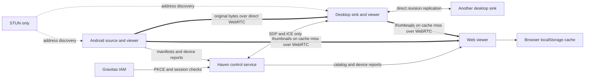

# Architecture and protocol v1

Roles are capabilities: `viewer` is always present; Android can also be `source`;
desktop can additionally be `source` and/or `sink`. The user's “sync” is modeled
as a sink participating in bidirectional revision replication. A web browser is
a viewer. Every role uses the same virtual namespace.

## Catalog

`Device` has an account, roles, platform, heartbeat, and revocation flag.
`Asset` has a stable ID, kind, normalized virtual path, MIME, capture time, and
immutable revision descriptors. A revision has an ID, byte size, SHA-256, author
device, and timestamp. `Replica` records the asset/revision/device and receipt
time. `Transfer` binds an exact asset/revision to an authorized source and sink.

Publishing includes the base revision. A stale base creates a separate asset
with `conflict_of` and a disambiguated filename. Case-insensitive collisions are
also preserved as named copies. Path validation excludes traversal, absolute
paths, alternate Windows streams, reserved filenames, and the private `.haven`
namespace. Source publication advertises available bytes; a sink receipt adds a
verified replica. Current-head sink receipts drive the viewer's stored count.

## Control endpoints

All `/api` operations except configuration and login require a Haven session.
Web uses a host-only HttpOnly cookie; native uses an opaque bearer stored in OS
secure storage. The backend stores only its hash plus an encrypted IAM session
envelope. Mutations require `X-Haven-CSRF: 1` and, when supplied, an exact origin.
Sessions each bind to one device. Revoking it denies its subsequent API requests.

| Method | Endpoint | Purpose |
| --- | --- | --- |
| GET | `/api/config` | STUN URLs, namespaces, development flag, frame size |
| GET | `/api/me` | Current account and bound device |
| GET/POST | `/api/devices` | List devices; register/update the calling device |
| POST | `/api/devices/heartbeat` | Update presence |
| DELETE | `/api/devices/{id}` | Revoke an owned device |
| GET/POST | `/api/assets` | Catalog; publish a descriptor and base revision |
| POST | `/api/thumbnail-requests` | Request a current revision from an online source or sink |
| POST/GET | `/api/reports` | Sources/sinks submit status; viewers read account-scoped reports |
| GET | `/api/transfers` | Account transfer plans |
| POST | `/api/transfers/{id}` | Status or sink-only hash receipt |
| POST/GET | `/api/signals` | Authorized offer/answer/ICE; cursor-based polling |
| POST | `/api/auth/native/start` | Begin challenge-bound native browser login |
| POST | `/api/auth/native/poll` | Redeem a completed approval once |
| POST | `/api/auth/logout` | Revoke the local session, even during an IAM outage |

JSON control bodies are limited to 32 KiB. SDP/ICE is capped at 24 KiB per
envelope, 256 signals per transfer, 4,096 total, and a 10-minute TTL. Neither
originals nor thumbnail bytes have an HTTP route. Signaling is transient;
catalog, sessions, revisions, receipts, and device reports survive restarts.

## Cache-first thumbnails and device reports

The viewer checks its local cache before making a thumbnail request. Web caches
use browser `localStorage`, scoped to the backend/account and keyed by asset ID
and exact revision. Cache hits need no peer connection. Entries are bounded to
1.5 million base64/JSON characters, evict older entries, and are cleared on
explicit sign-out. Blocked storage or quota errors fall back to a bounded memory
cache with a visible message; the server never becomes a byte fallback.

On a miss, `POST /api/thumbnail-requests` selects an online, unrevoked source or
sink with the current original revision. It creates a `purpose: thumbnail` job.
The sender offers an ordered reliable `haven-thumbnail-v1` data channel. Thumbnail
bytes are generated on that device or read from its own cache. The receiver
accepts only a matching revision, up to 128 KiB, checks length/SHA-256 and PNG/JPEG
dimensions up to 512×512 before caching. Thumbnail receipts never add an original
replica or increase the stored-copy count. Unavailable peers are deprioritized
on a later request so another source/sink can supply the thumbnail. A missing
thumbnail remains a placeholder while all usable peers are offline or direct
connectivity is unavailable. Native apps use an in-memory thumbnail cache.

Sources and sinks report every 15 seconds while open, independently of gallery
scanning. Reports contain the total pending count, up to 32 sampled pending
items, last completed scan time and up to 16 active errors, trimmed to the JSON
body limit. The backend stamps the receiving time and device identity, validates
account ownership and persists the latest report per device. The Devices and
Transfers views show the last report and errors, marking reports stale after
45 seconds. Reports are advisory; only verified sink receipts count as backups.
Reports from revoked devices are hidden. No contact/note bodies or media bytes
are included. Older clients need an update to serve direct thumbnails; the old
backend thumbnail endpoints return 404 and the legacy derived disk cache is
removed on startup.

## Byte protocol

One ordered reliable data channel named `haven-v1` carries one exact revision:

1. Sender: `start { revision, sha256, size }`.
2. Receiver validates the descriptor and returns `ready { offset }` from its
   persisted `.part` file.
3. Sender sends binary frames up to 16 KiB. At most 256 KiB remains unacknowledged.
   Receiver appends/flushed bytes at the expected offset and sends `ack { offset }`.
4. After all bytes are acknowledged, sender sends `done`.
5. Receiver verifies full length and SHA-256, retains an existing old original,
   commits the partial to the visible filesystem, saves its local index, and
   posts a receipt to the backend. Only then does it return `complete`.

Corrupt partials are discarded. Incomplete partials remain for another attempt.
An unexpected offset or unsent local edit blocks replacement. Peer timeouts
leave the transfer waiting and retry at a bounded cadence. Source files are
never removed by this process. Initial sink synchronization is per-file; there
is no claim of an atomic whole-library snapshot.

## Extension points

`Media/`, `Files/`, `Structured/Contacts/`, and `Structured/Notes/` are independent
roots. Structured adapters serialize versioned payloads conforming to
`schemas/structured-v1.schema.json`, then use the same revision/hash/replica byte
pipeline. The backend stores descriptors, not contacts or notes bodies. Field
merging, CRDTs, tombstones, and schema upgrades can be added above this layer
without routing originals through the coordinator.

The snapshot store is intentionally single-process. Its updates mutate a private
clone and atomically replace an fsynced owner-private snapshot; failed writes
leave the active state unchanged. Only control metadata and device reports are persisted on the backend.
For scale, replace this with transactional storage behind the same API, not a
second uncoordinated JSON writer.
